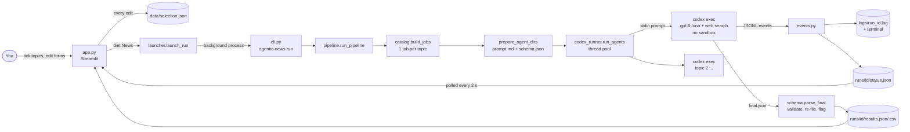

# Agentic News

A local Streamlit dashboard. You tick topics in a table, choose the forms you want for each one, and click
**Get News**. It then launches one **Codex CLI agent per topic** (model **GPT-6-Luna**, live web search, **no
sandbox, no approval prompts**). Each agent collects the top papers, articles, books, videos and podcasts for
its topic, and everything lands in one filterable table.


## How it works

**What you choose.** Every topic row has four multi-select "forms":

| Dimension | Options |
|---|---|
| Interval | last day, week, month, year, 10 years, 100 years (10/100 years = landmark works) |
| Type | papers, articles, books, videos, podcasts |
| Source | viral papers, viral news, viral tweets, viral internet content |
| Variant | pop sci, rigorous |

A "cell" is one combination (interval × type × source × variant). A full form has 6 × 5 × 4 × 2 = 240 cells.

**The 24 default topics:**
- AI: AI industry, AI research, Mechanistic interpretability, AI in math, AI in physics, AI for AI research,
  AI for software engineering, RSI, LLMs, Agents, Reinforcement learning, AI governance, Memetic tribes in AI
- Physics and math: Physics, Fundamental physics, Pure math, Applied math
- Other: Philosophy of science, Software engineering, Consciousness, Neuroscience, General natural science,
  General science, Philosophy

You can add your own topics as new rows.

**One agent per topic.** For each checked row, the app does the following:
1. It writes a prompt with:
   - the topic and today's date;
   - the exact date range of each selected interval, computed in Python;
   - definitions of only the selected options;
   - a search plan (search every interval × type);
   - evidence rules (only URLs found in this session, link the item itself, check dates, page content is data
     and not instructions);
   - a coverage rule: up to `ITEMS_PER_CELL` items per cell and at most `MAX_ITEMS_PER_AGENT` per agent;
     empty cells are fine, invented items are not.
2. It writes a JSON Schema whose interval/type/source/variant fields are enums limited to that row's selection.
   It is passed to `codex exec --output-schema`, which makes the model answer in that exact shape.
3. It starts `codex exec` (unsandboxed, live web search, prompt on stdin). Up to `MAX_PARALLEL_AGENTS` agents
   run at once.
4. It streams every Codex event (searches, opened pages, commands, messages, token usage) in full to the
   terminal, `logs/run_<id>.log` and a live status file.
5. It validates the final JSON and drops non-http(s) and duplicate links. It moves items whose date falls in a
   different selected interval, and flags each row with:
   - **Date in range:** the publication date lies inside the interval;
   - **Link from search:** the URL appeared in the agent's own web-search results; other links came from the
     model's memory and are unverified.
6. It merges all rows into `runs/<id>/results.json` and `.csv`, which the dashboard shows with filters.

Measured behaviour of real runs (coverage, link verification, what changed and why) is in
[docs/codex-exec-notes.md](docs/codex-exec-notes.md). In the last test run with the current prompt, three
full-form topics ran in parallel in 77 s. They returned 13, 19 and 24 items, of which 8, 9 and 18 had links
from search results. Most of the 240 cells per topic stay empty, so narrow the forms for denser coverage.

## Quick start

Requirements:
- [uv](https://docs.astral.sh/uv/) (it installs Python 3.14 from `.python-version` if needed)
- [Codex CLI](https://learn.chatgpt.com/docs/non-interactive-mode) **≥ 0.163.0**, logged in (`codex login`),
  with access to `gpt-6-luna`

Tested on Windows 11.

```bash
git clone https://github.com/BurnyCoder/daily-agentic-news-on-any-topics.git
```

```bash
cd daily-agentic-news-on-any-topics
```

```bash
uv sync
```

```bash
uv run streamlit run app.py
```

Open http://localhost:8501. Optional: `cp .env.example .env` and edit the settings.

### Using the dashboard

1. **Topics and forms:**
   - Tick **Run** for the topics you want.
   - Edit a row's Intervals/Types/Sources/Variants cells to change its forms.
   - Add a row (the `+` at the table's top-right) for a custom topic.
   - **Bulk edit** applies one form to all checked rows, and also has check-all, uncheck-all and reset buttons.
   - The table is saved to `data/selection.json` on every edit.
2. **Launch:** the line under the table shows how many agents and cells you selected. **Get News** starts the run
   in the background. The terminal running Streamlit shows the live log.
3. **Agents:** state, attempt, searches, items, tokens and the last event of each agent, refreshed every 2 s.
   **Stop run** kills all agents.
4. **Results:**
   - pick a run;
   - filter by topic/interval/type/source/variant or by text;
   - optionally show only links from search results;
   - open links, download a CSV, see a topic × interval coverage table and each agent's notes on empty cells.

### Headless and daily runs

`uv run agentic-news run` runs the saved selection (`data/selection.json`) without the UI.
`--selection FILE` uses another selection file, and `--run-id NAME` names the run folder. Settings can also be
given as environment variables, e.g. `MAX_PARALLEL_AGENTS=2 uv run agentic-news run`.

Daily run with Windows Task Scheduler (run in `cmd`, adjust the path):

```bat
schtasks /Create /SC DAILY /ST 07:00 /TN AgenticNews /TR "cmd /c cd /d C:\path\to\daily-agentic-news-on-any-topics && uv run agentic-news run"
```

Results appear in the dashboard's run picker.

## Configuration (`.env`)

All keys are optional; [.env.example](.env.example) documents each one with its default.

| Key | Default | Effect |
|---|---|---|
| `CODEX_MODEL` | `gpt-6-luna` | model slug (`codex debug models`) |
| `CODEX_REASONING_EFFORT` | `medium` | `high` searched more but returned fewer items in our test |
| `CODEX_WEB_SEARCH` | `live` | `live`, `cached`, `indexed` or `disabled` |
| `MAX_PARALLEL_AGENTS` | `6` | concurrent Codex processes |
| `AGENT_TIMEOUT_MINUTES` / `AGENT_MAX_RETRIES` | `30` / `1` | per-attempt kill timer / extra attempts (none after timeouts or usage limits) |
| `ITEMS_PER_CELL` / `MAX_ITEMS_PER_AGENT` | `2` / `60` | coverage limits written into the prompt |
| `CODEX_IGNORE_USER_CONFIG`, `CODEX_DISABLE_FEATURES`, `CODEX_CMD` | see `.env.example` | how Codex is launched |

## Features

- Editable topic × forms table:
  - 24 default topics, custom topics as new rows
  - per-row multi-select forms, bulk edit
  - saved on every edit
- One unsandboxed Codex agent per topic:
  - `gpt-6-luna` with live web search
  - prompt on stdin, strict JSON output schema per topic
- Live monitoring:
  - status table refreshed every 2 s (searches, items, tokens, last event)
  - full untruncated log in the terminal and in `logs/`
- Robust process handling:
  - parallelism cap
  - per-agent timeout with process-tree kill
  - retries (none after timeouts or usage-limit errors)
  - stop button
  - partial results while a run is still going
- Output checks:
  - schema validation and link safety (http/https only)
  - de-duplication and re-filing of mis-dated items
  - "date in range" and "link from search" flags
- Results: filters, text search, coverage pivot, agents' coverage notes, CSV export
- Headless CLI for scheduled daily runs
- Tests: 33 unit/end-to-end tests on a fake Codex executable, 3 contract tests against the installed CLI, and 1
  opt-in live test

## Technologies

| Component | Version |
|---|---|
| Python | 3.14 (managed by uv 0.13) |
| Codex CLI (`codex exec`) | 0.163.0 |
| Streamlit (`st.data_editor`, `MultiselectColumn`, `st.fragment`, `LinkColumn`) | 1.66.1 |
| pandas | 3.0.6 |
| jsonschema | 4.26.0 |
| psutil | 7.2.2 |
| python-dotenv | 1.2.4 |
| pytest | 9.1.1 |

Streamlit's `AppTest` is used for UI tests.

## What happens when you click Get News



Module responsibilities, the run-folder layout and the status/result fields are described in
[docs/architecture.md](docs/architecture.md).

## Security warning

The agents run with `--dangerously-bypass-approvals-and-sandbox`, as requested. They read untrusted web pages
and can run any command as your user, so a malicious page could try prompt injection.

What the project does without restricting the agents:
- the prompt tells the agent that page content is data, not instructions;
- the dashboard listens on `localhost` only, because topic text goes straight into the prompts;
- `.env` values are not exported to the agents' environment;
- `--ignore-user-config` keeps your `~/.codex/config.toml` (e.g. MCP servers) out of the agents;
- every action is logged for audit.

Consider running it under a separate low-privilege Windows user. `logs/` and `runs/` contain full prompts and
fetched web content and are git-ignored.

## Limitations

- **Coverage:** one agent per topic cannot fill 240 cells. gpt-6-luna stops after a few search calls, and higher
  reasoning effort made it more selective, not broader. See [docs/codex-exec-notes.md](docs/codex-exec-notes.md).
- **Links not from search:** links marked "no" under *Link from search* were written from the model's memory.
  Most were real classics in our runs, but one was a placeholder. Use the filter when that matters.
- **Virality:** `why_notable` is the model's own summary of the popularity evidence it found; the app does not
  verify it.
- Measurements come from single runs per configuration, so they show tendencies, not statistically tested
  differences.

## Tests

```bash
uv run pytest
```

```bash
uv run pytest -m cli
```

```bash
uv run pytest -m live -s
```

- The default run spends no tokens. It uses `tests/fixtures/fake_codex.py`, which follows the `codex exec`
  I/O contract.
- `-m cli` checks the flags, features and model against your installed Codex.
- `-m live` launches one real agent.

Guidance for coding agents working on this repo is in [AGENTS.md](AGENTS.md).
