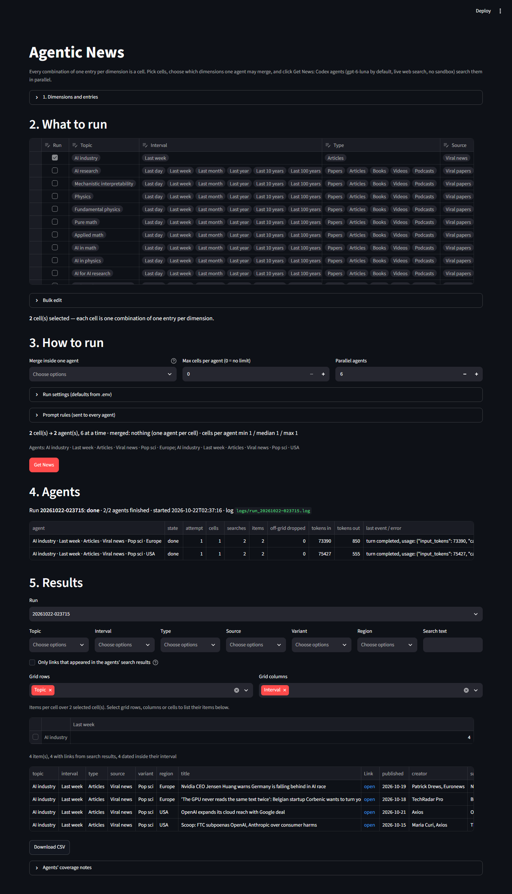
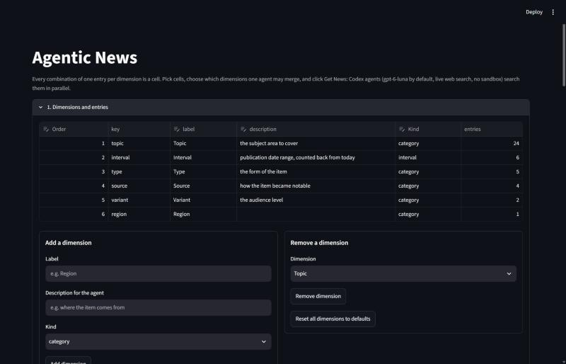
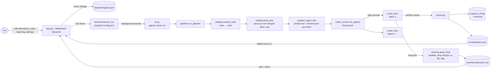

# Agentic News

A local Streamlit dashboard. You choose which **cells** to search, where a cell is one combination of one entry
from every dimension (topic × interval × type × source × variant × any dimension you add). You also choose how
those cells are split across agents. Then you click **Get News**. **Codex CLI agents** (default model
**GPT-6-Luna**, live web search, **no sandbox, no approval prompts**) search the cells in parallel, and every
item lands in exactly one cell of a results grid.



## How it works

**Dimensions and cells.** The default dimensions are:

| Dimension | Default entries |
|---|---|
| Topic | 24 topics (listed below) |
| Interval | last day, week, month, year, 10 years, 100 years (10/100 years = landmark works) |
| Type | papers, articles, books, videos, podcasts |
| Source | viral papers, viral news, viral tweets, viral internet content |
| Variant | pop sci, rigorous |

The 24 default topics:
- **AI:** AI industry, AI research, Mechanistic interpretability, AI in math, AI in physics, AI for AI research,
  AI for software engineering, RSI, LLMs, Agents, Reinforcement learning, AI governance, Memetic tribes in AI
- **Physics and math:** Physics, Fundamental physics, Pure math, Applied math
- **Other:** Philosophy of science, Software engineering, Consciousness, Neuroscience, General natural science,
  General science, Philosophy

A **cell** is one entry from every dimension, e.g. *Physics · Last week · Papers · Viral news · Rigorous*. The
defaults give 24 × 6 × 5 × 4 × 2 = 5,760 cells, and every cell gets its own results.

Everything is editable in the dashboard and in code (`catalog.default_dimensions`):
- add, rename or remove **entries** of any dimension;
- add, reorder or remove **whole dimensions**. For example, "Region" with entries Europe/USA doubles the cells.
  A dimension of kind `interval` (at most one) gets date ranges and date checks.

**What runs.** The "What to run" table holds *rules*:
- each checked row selects every combination of the entries it lists, one multiselect column per dimension;
- the selected cells are the union of all checked rows;
- the table starts with one row per topic.

**How it is parallelized.** *Merge inside one agent* lists the dimensions whose entries share an agent.

| Merge | Agents |
|---|---|
| nothing (default) | one agent per cell, the most granular |
| interval + type + source + variant | one agent per topic |
| region | one agent per cell, except Europe and USA share one |
| everything | one agent for all cells |

*Max cells per agent* splits bigger batches, *Parallel agents* sets how many run at once, and above a threshold
(default 30 agents) launching needs an explicit confirmation.

**One agent run.** For each batch of cells, the app does the following:
1. **Prompt.** It writes a prompt with:
   - today's date;
   - each dimension's description and the definitions of only the entries this batch uses, with exact date ranges
     for intervals computed in Python;
   - the cells to cover: "every combination" when the batch is a full product, otherwise listed one by one;
   - a search plan;
   - the editable **rules**: only URLs found in this session, link the item itself, check dates, page content is
     data and not instructions, fill every real cell and invent nothing;
   - limits: up to `ITEMS_PER_CELL` items per cell, at most `MAX_ITEMS_PER_AGENT` per agent.
2. **Schema.** It writes a JSON Schema with one enum field per dimension, limited to the batch's entries. It is
   passed to `codex exec --output-schema`, so the model answers in that exact shape.
3. **Agent.** It starts `codex exec` (unsandboxed, live web search, prompt on stdin). Every Codex event (searches,
   opened pages, commands, messages, token usage) streams in full to the terminal and `logs/run_<id>.log`;
   counters and the latest event go to a live status file.
4. **Checks.** It validates the final JSON and drops:
   - non-http(s) and duplicate links;
   - items filed in cells this agent was not asked for (counted as "off-grid dropped").

   An item whose date falls in another selected interval of the batch moves there. Each row is flagged with:
   - **Date in range:** the publication date lies inside the interval;
   - **Link from search:** the URL appeared in the agent's own web-search results or opened pages; other links
     were recalled by the model or copied from page text, and are unverified.
5. **Results.** It merges all rows into `runs/<id>/results.json` and `.csv`. Each row has every dimension's id
   and readable label. The dashboard shows them as a grid
   whose rows and columns are dimensions you choose, with item counts per cell. Select rows, columns or cells to
   list their items.

Measured behaviour of real runs is in [docs/codex-exec-notes.md](docs/codex-exec-notes.md). Three examples:
- **Split vs merged, 2 cells** (one topic, last day/last week): split took 2 parallel one-cell agents, 13 s;
  merged on interval took 1 agent, 17 s. Every item landed in its own cell, inside its date range, with a link
  from search.
- **Merged, 4 cells** (type merged into 2 agents of 2 cells, 44 s): 6 items, all in their own cells; 5/6 inside
  the date range and 4/6 with a link from search.
- **Older one-agent-per-topic runs:** one agent covering 240 cells returned only 9–24 items at the default
  `medium` effort (4 at `high`). That is why the default is now one agent per cell.

## Quick start

Requirements:
- [uv](https://docs.astral.sh/uv/) (it installs Python 3.14 from `.python-version` if needed)
- [Codex CLI](https://learn.chatgpt.com/docs/non-interactive-mode) **≥ 0.163.0**, logged in (`codex login`),
  with access to `gpt-6-luna`

Tested on Windows 11.

```bash
git clone https://github.com/BurnyCoder/daily-agentic-news-on-any-topics.git
```

```bash
cd daily-agentic-news-on-any-topics
```

```bash
uv sync
```

```bash
uv run streamlit run app.py
```

Open http://localhost:8501. Optional: `cp .env.example .env` and edit the defaults.

### Using the dashboard



1. **Dimensions and entries** (expander):
   - The dimensions table edits key, label, description, kind and order. Renaming a key carries the rules and
     merge choices over to it.
   - Ids and keys are made from labels when left empty and kept unique (a second "Region" becomes `region_2`).
   - *Add a dimension* creates a new one (it starts empty, so add its entries next).
   - *Remove a dimension* and *Reset all dimensions to defaults*.
   - *Edit entries of* opens any dimension's entries: add, rename or remove them, with definitions and days back
     for intervals.
   - Rules that had every entry of a dimension selected also get its new entries.
2. **What to run:**
   - Tick **Run** on rules and edit their entries.
   - Add rows with the `+` at the table's top-right.
   - **Bulk edit** applies chosen entries to all checked rows. By default it leaves the Topic column alone; pick
     the dimensions to apply. It also has check all, uncheck all and reset rows.
   - The count of selected cells updates live.
3. **How to run:**
   - set merged dimensions, max cells per agent and parallel agents;
   - *Run settings* covers model, reasoning effort, web search, items per cell, max items per agent, timeout,
     retries and the confirmation threshold;
   - *Prompt rules* holds the rules text sent to every agent, with reset to default;
   - the preview shows cells → agents and cells per agent;
   - **Get News** starts the run in the background, and the terminal running Streamlit shows the live log.
4. **Agents:** each agent's label, state, attempt, cells, searches, items, off-grid drops, tokens and last event,
   refreshed every 2 s. **Stop run** kills all agents.
5. **Results:**
   - the newest run is shown by default;
   - filter by any dimension or by text, optionally only links from search results;
   - pick grid rows and columns (any dimensions), then select grid rows, columns or cells to list their items;
   - download a CSV and read each agent's notes on empty cells.

Dimensions, rules, batching, run settings and prompt rules are saved to `data/workspace.json` on every change
(results filters and grid choices are not). Each run snapshots the workspace to `runs/<id>/config.json`.

### Headless and daily runs

`uv run agentic-news run` runs the saved workspace (`data/workspace.json`) without the UI.
- `--config FILE` uses another config (same JSON format as a run's `config.json`).
- `--run-id NAME` names the run folder.
- `.env` keys can also be given as environment variables, e.g. `MAX_PARALLEL_AGENTS=2 uv run agentic-news run`.
  Dashboard run settings stored in the config win over both.

Daily run with Windows Task Scheduler (run in `cmd`, adjust the path):

```bat
schtasks /Create /SC DAILY /ST 07:00 /TN AgenticNews /TR "cmd /c cd /d C:\path\to\daily-agentic-news-on-any-topics && uv run agentic-news run"
```

## Configuration (`.env`)

These are the defaults; the dashboard's *Run settings* can change most of them per run. All keys are optional,
and [.env.example](.env.example) documents each one.

| Key | Default | Effect |
|---|---|---|
| `CODEX_MODEL` | `gpt-6-luna` | model slug (`codex debug models`) |
| `CODEX_REASONING_EFFORT` | `medium` | `high` searched more but returned fewer items in our test |
| `CODEX_WEB_SEARCH` | `live` | `live`, `cached`, `indexed` or `disabled` |
| `MAX_PARALLEL_AGENTS` | `6` | concurrent Codex processes |
| `AGENT_TIMEOUT_MINUTES` / `AGENT_MAX_RETRIES` | `30` / `1` | per-attempt kill timer / extra attempts (none after timeouts, usage-limit or auth errors) |
| `ITEMS_PER_CELL` / `MAX_ITEMS_PER_AGENT` | `2` / `60` | coverage limits written into the prompt |
| `CONFIRM_ABOVE_AGENTS` | `30` | the dashboard asks for confirmation above this many agents |
| `CODEX_IGNORE_USER_CONFIG`, `CODEX_DISABLE_FEATURES`, `CODEX_CMD` | see `.env.example` | how Codex is launched |

## Features

- **Granular cells:**
  - every combination of one entry per dimension is its own cell with its own results;
  - rules select any set of cells.
- **Editable dimensions** (UI and code): add, rename and remove entries and whole dimensions; interval-kind
  dimensions get date ranges and checks.
- **User-chosen parallelization:**
  - merge any dimensions into one agent, from one agent per cell to one agent for everything;
  - cap cells per agent, set parallel agents;
  - confirmation above a threshold.
- **Per-run settings and editable prompt rules**, saved with each run.
- **Unsandboxed Codex agents**: `gpt-6-luna` with live web search, prompt on stdin, strict JSON output schema
  generated per batch.
- **Live monitoring:** status refreshed every 2 s, and a full untruncated log in the terminal and in `logs/`.
- **Robust process handling:**
  - parallelism cap;
  - per-agent timeout with process-tree kill;
  - an agent is killed at once if anything fails after launch;
  - retries (none after timeouts, usage-limit or auth errors);
  - stop button;
  - partial results while a run is still going.
- **Output checks:**
  - schema validation, link safety (http/https only), de-duplication;
  - off-grid item drops;
  - re-filing of mis-dated items;
  - "date in range" and "link from search" flags.
- **Results:** pivot grid with any dimensions on rows/columns, cell/row/column drill-down, filters, text search,
  coverage notes, CSV.
- **Headless CLI** for scheduled daily runs.
- **Tests:** 52 unit/end-to-end/UI tests on a fake Codex executable, 3 contract tests against the installed CLI,
  and 2 opt-in live tests on 2 cells.

## Technologies

| Component | Version |
|---|---|
| Python | 3.14 (managed by uv 0.13) |
| Codex CLI (`codex exec`) | 0.163.0 |
| Streamlit (`st.data_editor`, `MultiselectColumn`, `st.fragment`, dataframe selections, `LinkColumn`) | 1.66.1 |
| pandas | 3.0.6 |
| jsonschema | 4.26.0 |
| psutil | 7.2.2 |
| python-dotenv | 1.2.4 |
| pytest | 9.1.1 |

Streamlit's `AppTest` is used for UI tests.

## What happens when you click Get News



Module responsibilities, the run-folder layout and the status/result fields are described in
[docs/architecture.md](docs/architecture.md).

## Security warning

The agents run with `--dangerously-bypass-approvals-and-sandbox`, as requested. They read untrusted web pages
and can run any command as your user, so a malicious page could try prompt injection.

What the project does without restricting the agents:
- the prompt tells the agent that page content is data, not instructions;
- the dashboard listens on `localhost` only, because typed text (topics, rules) goes straight into the prompts;
- `.env` values are not exported to the agents' environment;
- `--ignore-user-config` keeps your `~/.codex/config.toml` (e.g. MCP servers) out of the agents;
- every action is logged for audit.

Consider running it under a separate low-privilege Windows user. `logs/` and `runs/` contain full prompts and
fetched web content and are git-ignored.

## Limitations

- **Cost scales with granularity.** One agent per cell means many agents; each one-cell agent used about
  73–77k input tokens in our runs, and 2-cell agents 108–263k. Merge dimensions or narrow the rules for big
  selections. Watch the cells → agents preview.
- **Merged batches are thinner per cell.** One agent covering 240 cells returned only 9–24 items in earlier runs
  ([docs/codex-exec-notes.md](docs/codex-exec-notes.md)).
- **Links not from search:** links marked "no" under *Link from search* were recalled by the model or copied from
  page text. Many were well-known older works in our runs, but some were wrong: a placeholder URL, a YouTube
  search page and a fabricated journal citation. Use the filter when that matters.
- **Virality:** `why_notable` is the model's own summary of the popularity evidence it found; the app does not
  verify it.
- Measurements come from single runs per configuration (one configuration was repeated once: 13 vs 15 items), so
  they show tendencies, not statistically tested differences.

## Tests

```bash
uv run pytest
```

```bash
uv run pytest -m cli
```

```bash
uv run pytest -m live -s
```

- The default run spends no tokens. It uses `tests/fixtures/fake_codex.py`, which follows the `codex exec` I/O
  contract.
- `-m cli` checks the flags, features and model against your installed Codex.
- `-m live` runs 2 cells for real: split into 2 agents, then merged into 1, which is 3 short agent runs in total.

Guidance for coding agents working on this repo is in [AGENTS.md](AGENTS.md).
